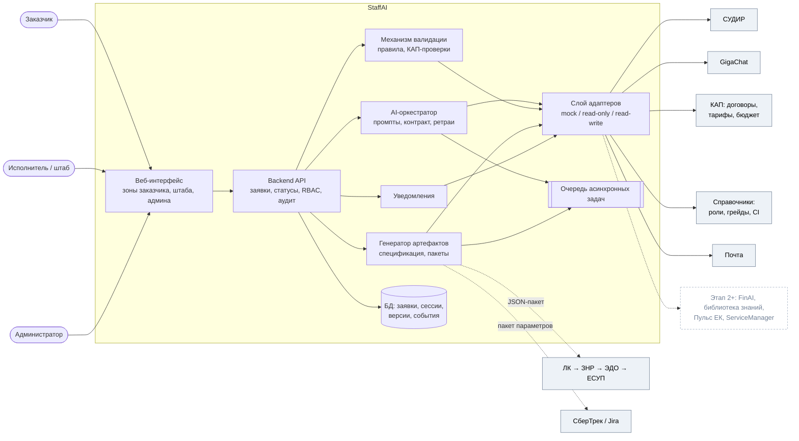

# Архитектура: обзор

> Источник: ТЗ v3 §6.6, §7; ts-v2 §3, §7 (bounded contexts); схема агента (карта зависимостей). Технологический стек
> **не выбран** (ОВ-01) и зависит от платформы размещения (АР-02). Решения фиксируются в [ADR](adr/).

## Контекстная схема

## Bounded contexts (ts-v2 §7, адаптировано под v3)

| Контекст | Отвечает за | Основные сущности | Спецификации |
|---|---|---|---|
| Request Intake | Диалог, файлы, шаблоны, первичный разбор | `DialogSession`, `RawInput`, `DocumentPackage`, `RequestTemplate` | 013, 020 |
| AI Orchestration | Промпты, извлечение, нормализация, противоречия, генерация, база знаний | `AiInference`, `ReferenceMatch` | 010–012, 016, 023 |
| Validation | Правила проверки, КАП-проверки, флаги, цикл пояснений | `ValidationReport`, `ValidationRuleSet` | 021, 022 |
| Request Lifecycle | Заявка, статусы, переходы, история | `Request`, `StatusHistory` | 001 |
| Staffing | Позиции, календаризация, варианты подрядчиков | `RequestRole`, `ContractorOption` | 014, 032 |
| Specification | Проект спецификации, версии, экспорт, маршрут согласования | `SpecificationVersion`, `ApprovalRoute` | 034, 035 |
| Downstream | Пакеты для ЛК и трекера | `LkConfigPackage`, `TrackerPackage` | 040, 041 |
| Reference Data | Справочники, синхронизация, кэш договорных данных | `Role`, `Grade`, `CiCode`, `Initiative` | 005 |
| Communication | Чат, уточнения, уведомления | `ClarificationThread`, `Message` | 031, 036 |
| Identity & Access | СУДИР, роли, видимость | — | 003 |
| Audit & Analytics | Журнал событий, метрики | `EventLog` | 002, 050 |

## Архитектурные принципы (обязательны — см. конституцию)

1. **Детерминированное ядро, LLM на периферии.** Статусы, доступ, расчёты, проверки, рассылки — код; LLM — интерпретация и тексты (ПР-5).
2. **Integration-first.** Каждая внешняя система — за адаптером с режимами `mock` / `read_only` / `read_write`; замена системы не трогает бизнес-логику.
3. **Деградация, а не отказ.** Недоступность внешней системы → отложенная задача синхронизации, ограниченный режим, локальное сохранение.
4. **Event-first аудит.** Любое значимое действие — событие журнала по единому контракту.
5. **Асинхронность длительных операций** (AI-анализ, генерация документов) с сохранением состояния сессии.
6. **Не источник истины для справочных данных**: КАП и справочники — первичны.
7. **Готовность к расширению** без изменения ядра: новые каналы обращения, интеграции Этапа 2.

## Решения, которые ещё не приняты

| # | Решение | Влияние | Где |
|---|---|---|---|
| АР-01 | Почтовый канал обращений | Периметр точек входа | open-questions |
| АР-02 | Платформа размещения: FinAI или ЛК | Модель интеграции, владения, НФТ, стек | open-questions |
| ОВ-01 | Технологический стек (язык backend, БД, очередь, фронтенд) | Все планы реализации | ADR-0003 (будет) |
