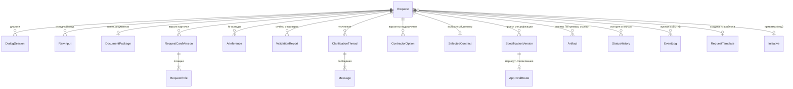

# Модель данных (базовая)

> Источник: ТЗ v3 §8 (+ прил. Е — детализируется на проектировании), ts-v2 §9. Это **концептуальная** модель: состав
> сущностей и связи. Физическая схема (типы, индексы, миграции) — в `data-model.md` планов конкретных спецификаций.

## Сущности

| Сущность | Назначение | Ключевые атрибуты / правила |
|---|---|---|
| `Request` | Заявка | `id`, уникальный `number` (формат — ОВ-10), `status`, `channel`, `customerId`, `executorId?`, `initiativeId?`, `templateId?`, даты |
| `DialogSession` | Сессия диалога с агентом | сообщения, состояние; восстановление прерванной сессии (НФТ) |
| `RawInput` | Исходный ввод | **неизменяем**, хранится отдельно от обработанных данных (ТЗ §8) |
| `DocumentPackage` / `DocumentItem` | Приложенные файлы | формат (TXT, MD, DOCX, PDF, XLSX), извлечённый текст, ссылка на хранилище |
| `RequestCardVersion` | Версия карточки запроса | версионируется; подтверждение заказчиком фиксирует версию |
| `RequestRole` | Позиция состава | роль (id справочника), грейд, количество, даты старта/окончания, требования (обязательные/желательные), формат работы |
| `AiInference` | AI-вывод | тип, вход (hash), выход (JSON по контракту), уверенность, источники, предположения, противоречия, кто подтвердил/исправил (ПР-4) |
| `ValidationReport` | Отчёт о проверке | набор правил (версия), ошибки, флаги |
| `ClarificationThread` / `Message` | Уточнения и чат | привязка к заявке и, желательно, к полю/блоку |
| `ContractorOption` | Вариант подрядчика | договор, покрытие ролей, тарифы, остаток бюджета, срок договора, рейтинг, `selected` |
| `SelectedContract` | Выбранный договор | фиксируется решением исполнителя |
| `SpecificationVersion` | Проект спецификации | версия, автор, время (ФТ-5.2); структурированное JSON-представление всегда; экспорт DOCX/PDF |
| `ApprovalRoute` / `ApprovalParticipant` | Маршрут согласования | участник, канал, статус получения и ответа |
| `Artifact` | Пакеты и документы | тип (`lk_config_package`, `tracker_package`, `spec_docx`, …), версия, статус |
| `RequestTemplate` | Шаблон запроса | `scope`: system / department / personal |
| `Initiative` | Справочник инициатив | локальная копия (интеграция с FinAI — перспектива) |
| `StatusHistory` | История статусов | from, to, актор, тип актора, причина, время |
| `EventLog` | Журнал событий | см. [events.md](events.md) |

Справочники (локальная копия + регламентная синхронизация, ИВ-6): роли, грейды, технологии, продукты, CI.
Договорные данные (КАП, ИВ-3) **не копируются как источник истины** — кэшируются с отметкой времени актуальности.

## Правила

- Исходный ввод ≠ обработанные данные: никогда не перезаписывать `RawInput`.
- Всё, что меняется после подтверждения, — **новая версия** (карточка, спецификация, артефакты), а не перезапись.
- Каждая ручная правка AI-данных хранит автора и время (ФТ-2.7).
- Плановая позиция ≠ кандидат ≠ утверждённый специалист: ФИО специалистов на этапе заказа неизвестны и не требуются
  (Замечания §14.2).
- Сроки хранения и архивирования — ТУ-09.
