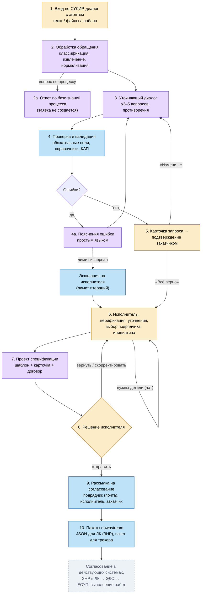

# Целевой процесс (Этап 1)

> Источник: ТЗ v3 §5.3, [схема процесса](../sources/02-process-scheme.md), [схема агента](../sources/03-agent-scheme.md).

## Сквозная схема



Легенда: 🟧 человек · 🟪 LLM · 🟦 детерминированный алгоритм · ⬜ вне периметра Системы.

## Шаги

| Шаг | Что происходит | Исполнение | Вход → выход | Требования |
|---|---|---|---|---|
| 1 | Вход через веб-сервис (СУДИР), начало диалога | Пользователь | — → исходный ввод, сессия диалога | ФТ-1.1, ИВ-2 |
| 2 | Извлечение параметров; для вопросов по процессу — ответ по базе знаний без создания заявки | LLM | исходный ввод → черновик карточки / ответ | ФТ-3.1, 3.2, 3.7, 3.8 |
| 3 | Уточняющий диалог: недостающие параметры, противоречия (≤3–5 вопросов) | LLM | черновик → дополненный черновик | ФТ-3.3, 3.4 |
| 4 | Проверка: полнота, обязательные поля, справочники, данные договоров КАП | Алгоритм | черновик + документы → отчёт о проверке | ФТ-4.1–4.3, 4.5 |
| 4а | Цикл пояснений: ошибки → LLM → понятные пояснения; до устранения, с лимитом и эскалацией | Алгоритм → LLM | отчёт → пояснения в диалоге | ФТ-4.4 |
| 5 | Карточка → подтверждение заказчиком → очередь штаба | LLM + человек | черновик → подтверждённая карточка | ФТ-1.2, 3.6 |
| 6 | Верификация, уточнения в чате, выбор подрядчика из рекомендаций, привязка к инициативе | Человек | карточка + анализ → выбранный подрядчик | ФТ-2.1–2.4, 2.6, 2.7, 3.5 |
| 7 | Проект спецификации (шаблон + карточка + договорные данные) | Алгоритм + LLM | карточка + договор + шаблон → проект v1 | ФТ-5.1–5.3, 2.5 |
| 8 | Решение: отправить / вернуть / скорректировать | Человек | проект → решение | ФТ-2.5 |
| 9 | Рассылка участникам, фиксация статусов | Алгоритм | решение «отправить» → маршрут согласования | ФТ-5.4 |
| 10 | Конфигурационный пакет для ЛК, пакет для трекера | Алгоритм | согласованные данные → пакеты | ФТ-3.6, ИВ-4, ИВ-5 |

Согласование в действующих системах и выполнение работ проходят **вне Системы**; их результат фиксируется статусом заявки.

## Кто что вводит (граница зон)

```text
ЗАКАЗЧИК сообщает            AI-АГЕНТ определяет/готовит      ИСПОЛНИТЕЛЬ проверяет/решает
─────────────────────        ─────────────────────────        ──────────────────────────────
потребность (текст, файл,    роли, грейды, количество         верификация выводов AI
  шаблон)                    нормализация по справочникам     уточнения у заказчика (чат)
ответы на уточнения          противоречия, вопросы            выбор подрядчика/договора
подтверждение карточки       обогащение данными КАП           проверка бюджета
пожелания по подрядчику      варианты подрядчиков             привязка к инициативе
согласование содержательной  проект спецификации (тексты)     правка спецификации
  части спецификации         пакеты для ЛК и трекера          решение «отправить/вернуть»
```

Заказчик **никогда** не вводит: номер договора, ставки, CI, бюджетные коды/контур, продукт ЕК, стратегическую тему,
этапы спецификации, подписантов подрядчика (ФТ-1.7, ПС-4).

## Что блокирует, а что — нет (критический путь)

| Блокирует старт обработки | Не блокирует (уточняется позже / определяется штабом) |
|---|---|
| Кто заказчик | Точный CI |
| Какие роли нужны и сколько | Точный договор и подрядчик |
| Ориентировочные сроки | Ставки, бюджетный контур |
| Общий контекст потребности | Этапность спецификации, backlog |

Источник: ts-v2 §5.0.1, Замечания §7.3, §8.2. Нужно для проекта спецификации — контролируется к шагу 7, а не к шагу 1.
