# Жизненный цикл заявки (статусная модель)

> **Канон:** ТЗ v3 §5.4. Таблица разрешённых переходов (приложение Б) требует валидации системным аналитиком — **ТУ-02**.
> Рабочий проект переходов и правил — в спецификации [001-request-lifecycle](../../specs/001-request-lifecycle/spec.md).
> Статусы меняет **только детерминированная логика** (ПР-5); LLM может лишь рекомендовать следующее действие.

## Основной поток

```mermaid
stateDiagram-v2
    direction LR
    [*] --> draft
    draft --> ai_intake
    ai_intake --> awaiting_customer_clarification
    awaiting_customer_clarification --> ai_intake
    ai_intake --> awaiting_customer_confirmation
    awaiting_customer_confirmation --> ai_intake : «Изменить»
    awaiting_customer_confirmation --> request_formed : «Подтвердить»
    request_formed --> submitted_to_staff
    submitted_to_staff --> staff_review
    staff_review --> awaiting_customer_clarification : уточнение штаба
    staff_review --> contractor_selection
    contractor_selection --> specification_drafting
    specification_drafting --> executor_decision
    executor_decision --> specification_drafting : скорректировать
    executor_decision --> sent_for_approval : отправить
    sent_for_approval --> approved
    approved --> znr_processing
    znr_processing --> in_execution
    in_execution --> completed
    completed --> archived
```

## Статусы

| # | Статус (ТЗ v3) | Код | Владелец шага | Смысл |
|---|---|---|---|---|
| 1 | Черновик | `draft` | Заказчик | Заявка создана, потребность не сформулирована |
| 2 | AI-приём | `ai_intake` | AI (система) | Агент обрабатывает ввод: извлекает, нормализует, проверяет |
| 3 | Ожидает уточнений заказчика | `awaiting_customer_clarification` | Заказчик | Агент или штаб задал вопросы |
| 4 | Ожидает подтверждения заказчика | `awaiting_customer_confirmation` | Заказчик | Карточка показана, ждём «Подтвердить / Изменить / Вопрос» |
| 5 | Запрос сформирован | `request_formed` | Система | Карточка подтверждена; фиксируется версия карточки |
| 6 | Передано штабу | `submitted_to_staff` | Очередь штаба | В очереди, исполнитель не назначен |
| 7 | Проверка штабом | `staff_review` | Исполнитель | Верификация выводов AI, правки |
| 8 | Выбор подрядчика | `contractor_selection` | Исполнитель | Сравнение вариантов, выбор |
| 9 | Подготовка спецификации | `specification_drafting` | Исполнитель + система | Генерация и правка проекта |
| 10 | Решение исполнителя | `executor_decision` | Исполнитель | Отправить / вернуть / скорректировать |
| 11 | Отправлено на согласование | `sent_for_approval` | Система | Рассылка выполнена, ждём ответов участников |
| 12 | Согласовано | `approved` | Система | Результат внешнего согласования зафиксирован |
| 13 | Оформление ЗНР | `znr_processing` | Исполнитель | Конфигурационный пакет передан в ЛК / ЗНР оформляется |
| 14 | Исполнение | `in_execution` | — (вне Системы) | Работы идут в действующих процессах |
| 15 | Завершено | `completed` | Система | Можно повторить заявку, сохранить как шаблон |

### Дополнительные статусы

| Статус | Код | Когда |
|---|---|---|
| Запрошено изменение | `change_requested` | Изменение состава/сроков/требований после формирования запроса — создаётся новая версия |
| Возвращено | `returned` | Исполнитель вернул на доработку (кому — см. ОВ-04) |
| Отменено | `cancelled` | Заказчиком (до определённого статуса) или исполнителем |
| Приостановлено | `suspended` | Временная остановка с сохранением состояния |
| В архиве | `archived` | Терминальное хранение по политике ТУ-09 |

## Инварианты

1. Одна потребность = одна заявка; все артефакты, сообщения и события привязаны к ней.
2. Любой переход — событие журнала `request_status_changed` (from, to, актор, причина) + запись в истории статусов.
3. Недопустимый переход отклоняется детерминированно (ФТ-6.1) и не меняет состояние.
4. Переход в `sent_for_approval` возможен **только** по явному действию исполнителя (human-in-the-loop).
5. Недоступность GigaChat или внешней системы не переводит заявку в «ошибочный» статус: работа продолжается в деградированном режиме.

## Сопоставление с другими моделями

Для миграции знаний из ТЗ v2 и прототипа. Новый код использует **только** коды из таблицы выше.

| ТЗ v3 | ТЗ v2 | Прототип v2.3 |
|---|---|---|
| `draft` | Draft | `draft` |
| `ai_intake` | AI Intake | `ai_intake` |
| `awaiting_customer_clarification` | Awaiting Customer Clarification; Awaiting Staff Clarification | `awaiting_customer_clarification`; `awaiting_staff_clarification` |
| `awaiting_customer_confirmation` | Awaiting Customer Confirmation | `awaiting_customer_confirmation` |
| `request_formed` | Structured Request Ready | `structured_request_ready` |
| `submitted_to_staff` | Submitted to Staff | `submitted_to_staff` |
| `staff_review` | Staff Review | `staff_review` |
| `contractor_selection` | Contractor Selection | `contractor_selection` |
| `specification_drafting` | Specification Drafting | `specification_drafting` |
| `executor_decision` | — | — |
| `sent_for_approval` | Customer Approval (частично) | `customer_approval` |
| `approved` | — | — |
| `znr_processing` | Contracting | `lk_config_ready`, `lk_approval`, `lk_approval_sent`, `znr_created`, `contracting` |
| `in_execution` | Specialists Sourcing, Specialists Onboarding | `specialists_sourcing` |
| `completed` | Completed | `completed` |
| — (вне MVP) | — | `tracker_task_creation`, `tracker_backlog_review`, `tracker_backlog_confirmed`, `tracker_task_created` |
| `change_requested` / `returned` | Change Requested / Returned to Customer | `change_requested` |
| `cancelled`, `suspended`, `archived` | Cancelled, Suspended, Archived | `cancelled` |
