# Дорожная карта

> Источник: [Этапы разработки](../sources/04-roadmap-phases.md). Оценки предварительные, подлежат валидации командой.
> Спецификации фич по фазам — в [реестре спецификаций](../../specs/README.md#реестр-спецификаций).

```mermaid
gantt
    title StaffAI Этап 1 (оценка, недели от старта)
    dateFormat  X
    axisFormat  %s
    section Подготовка
    Ф0 Снятие блокеров            :f0, 0, 3
    section Разработка
    Ф1 Каркас платформы           :f1, after f0, 4
    Ф2 AI-агент + заказчик        :f2, after f1, 5
    Ф3 Валидация + уточнения      :f3, after f2, 4
    Ф4 Штаб + спецификация        :f4, after f2, 5
    Ф5 Downstream ЛК и трекер     :f5, after f4, 3
    section Выход
    Ф6 Стабилизация, ПСИ, пилот   :f6, after f5, 6
```

Суммарно до промышленного контура — **5–6 месяцев** при закрытии блокеров Ф0 и параллельной работе фронтенда и бэкенда.
Ф3 и Ф4 идут параллельно только при достаточной численности бэкенда; иначе последовательно.

| Фаза | Содержание | Оценка | Выход (gate) | Спецификации |
|---|---|---|---|---|
| **Ф0** | Подготовка и снятие блокеров | 2–3 нед | Утверждённый скоуп MVP, ресурсы, доступы | — (организационная) |
| **Ф1** | Каркас: backend, БД, СУДИР, CI/CD, адаптеры, справочники | 3–4 нед | «Пустая» заявка проходит жизненный цикл на стенде, всё логируется, вход по СУДИР работает | 001–006 |
| **Ф2** | AI-агент и рабочее место заказчика | 4–5 нед | ПС-1 (путь заказчика до подтверждения карточки) на стенде; точность извлечения ≥ порога | 010–016 |
| **Ф3** | Проверка и валидация, цикл пояснений, база знаний | 3–4 нед | ПС-2, ПС-3 на стенде | 020–023 |
| **Ф4** | Штабной контур, проект спецификации, согласование | 4–5 нед | Сквозной прогон Этапа 1 на стенде; демо инициатору и штабу | 030–036 |
| **Ф5** | Downstream: конфигурация для ЛК, пакет для трекера | 2–3 нед | Конфигурация принята тестовым ЛК; ПС-5, ПС-6 | 040–041 |
| **Ф6** | НФТ, ИБ, ПСИ, пилот | 4–6 нед | Промышленный контур; пилот завершён; ПС-7, ПС-8 | 050 |
| Ф7 (Этап 2) | Проверка артефактов, подготовка оплаты | после Ф1–Ф5 | Отдельная постановка | — |

## Ф0 — блокеры, которые надо запускать в первый день

| # | Задача | Owner | Блокирует |
|---|---|---|---|
| 0.1 | Утвердить границы MVP | Инициатор + КР | Всё (ТУ-11) |
| 0.2 | Ресурсный запрос: devops и системный аналитик | Инициатор | Ф1 инфраструктура |
| 0.3 | Системный аналитик валидирует ТЗ на ИТ-ландшафт | Инициатор + КР | Ф2+ (ТУ-02) |
| 0.4 | Доступы: СУДИР, GigaChat, API КАП — **длинные согласования, запускать первыми** | КР + Инициатор | Ф1/Ф2 (ТУ-01, ТУ-04) |
| 0.5 | Встреча с владельцами КАП: API, структура, SLA | КР / SA | Ф3/Ф4 рабочий режим (ТУ-05) |
| 0.6 | Встреча с владельцами ЛК: механизм ЗНР, формат конфигурации | Инициатор | Ф5 (ТУ-06) |
| 0.7 | Контур размещения (FinAI или ЛК) | Инициатор | Ф6 (АР-02) |
| 0.8 | Со штабом: канонический шаблон спецификации и контрольный перечень проверок | Инициатор / Штаб | Ф3/Ф4 (ТУ-03) |
| 0.9 | Ранняя проверка архитектуры на требования ИБ | КР | Снижает риски Ф6 (ТУ-10) |
| 0.10 | Передать пакет документации как источник истины | Инициатор | ✅ этот репозиторий |

**SDD-дополнение к Ф0:** выбрать технологический стек и зафиксировать ADR (ОВ-01), утвердить конституцию,
собрать эталонный набор реальных запросов со штабом (нужен к Ф2, задача 2.10).

## Критический путь

1. **Интеграция с КАП** — валидация, подбор подрядчика, ставки в спецификации.
2. **Интеграция с ЛК** — конфигурация, ЗНР.

У обеих есть резервный сценарий (заглушка, выгрузка, ручная передача конфигурации), поэтому разработка не стоит —
но ценность промышленного контура без действующих интеграций ограничена. Адаптеры с режимом `mock` закладываются с Ф1.

## Ресурсы и риски

| Роль | Нужна для | Риск при отсутствии |
|---|---|---|
| Фронтенд | Ф1–Ф4 | Замедление интерфейсных фаз |
| Бэкенд | Все фазы | Основной фактор длительности; определяет параллельность Ф3/Ф4 |
| Devops | Ф1, Ф6 | Инфраструктура ложится на бэкенд |
| Системный аналитик | Ф0, Ф2 (контракт данных), Ф5 (ЛК) | Незаземлённое ТЗ, переделки интеграций |
| Эксперт процесса (штаб) | Ф0 (шаблоны, чек-лист), Ф3 (база знаний), Ф4 (приёмка) | Несоответствие форм и правил реальному процессу |
