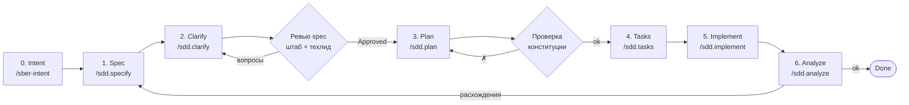

# Процесс разработки: Spec-Driven Development

> Решение: [ADR-0001](architecture/adr/0001-adopt-spec-driven-development.md). Принципы: [конституция](../.specify/memory/constitution.md).
> Структура совместима с [GitHub Spec Kit](https://github.com/github/spec-kit) (`.specify/`, `specs/NNN-*`);
> команды адаптированы под StaffAI и лежат в `.claude/commands/sdd.*.md` — их могут выполнять как Claude Code
> (слэш-командами), так и любой другой ИИ-агент или человек (это обычные инструкции в Markdown).

## Идея

Спецификация — главный артефакт; код — её производная. Мы не «пишем код и потом документируем», а:
сначала договариваемся **что и зачем** (spec), затем **как** (plan), затем **в каком порядке** (tasks), и только потом
реализуем — человеком или ИИ-агентом. Это даёт ИИ-агентам однозначный контекст, а команде — общее понимание.

## Жизненный цикл фичи



| Шаг | Команда | Результат | Кто утверждает |
|---|---|---|---|
| 0. Intent | `/sber-intent` | Daily Intent Brief → `docs/intents/ГГГГ-ММ-ДД-тема.md` | Команда (ежедневно, опционально для фичи) |
| 1. Specify | `/sdd.specify <описание или ID из реестра>` | `specs/NNN-name/spec.md` (статус Draft) | — |
| 2. Clarify | `/sdd.clarify NNN` | Ответы в spec, вопросы к стейкхолдерам в `docs/open-questions.md` | Статус → Clarified |
| Ревью spec | PR | Смысл — штаб/SA, реализуемость — техлид | Статус → **Approved** |
| 3. Plan | `/sdd.plan NNN` | `plan.md`, `research.md`, `data-model.md`, `contracts/`, ADR при необходимости | Техлид; статус spec → Planned |
| 4. Tasks | `/sdd.tasks NNN` | `tasks.md` | — |
| 5. Implement | `/sdd.implement NNN [T###]` | Код + тесты, отмеченные задачи | Код-ревью; статус → In Progress |
| 6. Analyze | `/sdd.analyze NNN` | Отчёт о согласованности spec ↔ plan ↔ tasks ↔ код ↔ конституция | Статус → **Done** |

Другие команды: `/onboard` — объяснить проект/вопрос по документации со ссылками.

## Структура спецификации

```text
specs/NNN-short-name/
├── spec.md          # ЧТО и ЗАЧЕМ — шаблон .specify/templates/spec-template.md
├── plan.md          # КАК — шаблон .specify/templates/plan-template.md
├── research.md      # исследования и отклонённые альтернативы
├── data-model.md    # физическая модель данных фичи
├── contracts/       # OpenAPI, JSON Schema (события, AI-контракты, пакеты ЛК/трекера)
└── tasks.md         # задачи — шаблон .specify/templates/tasks-template.md
```

Нумерация `NNN` — по фазам дорожной карты (001–009 Ф1, 010–019 Ф2, 020–029 Ф3, 030–039 Ф4, 040–049 Ф5, 050+ Ф6/сквозные,
060+ администрирование). Новые фичи берут следующий свободный номер в своей фазе.

## Правила

1. **Спецификация не содержит реализации.** Стек, таблицы, эндпоинты — только в plan.md.
2. **Каждое требование трассируется** к источнику (ФТ/ПР/ИВ/ПС ТЗ v3 или иной документ по иерархии).
3. **Не додумывать.** Неясность → `[NEEDS CLARIFICATION: …]` + строка в `docs/open-questions.md`.
   Спецификация с блокирующими вопросами не утверждается.
4. **Изменение требований — через спецификацию.** Поменялось поведение → сначала обновляем spec (и plan), потом код.
   Код, расходящийся со спецификацией, — дефект одного из двух.
5. **Маленькие спецификации.** Одна спецификация ≈ одна независимо демонстрируемая возможность, 1–3 недели работы.
6. **Документация обновляется в том же PR:** глоссарий (новые термины), события, модель данных, трассировка.

## Definition of Ready / Done

**Spec Ready (Approved):** чек-лист раздела 7 шаблона выполнен; ревью штаба/SA и техлида пройдено.

**Plan Ready:** проверка конституции пройдена дважды (до и после проектирования); стек определён ADR; контракты описаны.

**Done:**
- все задачи tasks.md отмечены; приёмочные сценарии автоматизированы и зелёные;
- тесты режимов отказа зависимостей есть;
- для AI-фич — eval на эталонном наборе не ниже порога;
- `/sdd.analyze` без критичных замечаний;
- документация и трассировка обновлены; статус spec → Done.

## Работа с ИИ-агентами

- Агент получает **одну** задачу из `tasks.md` (или фазу) и контекст: spec.md, plan.md, конституцию, AGENTS.md.
- Агент не выходит за рамки задачи; найденные пробелы требований он фиксирует, а не закрывает допущениями.
- Результат агента проходит обычное ревью; тесты обязательны.
- Реальные данные банка в промпты внешних ассистентов не передаются (Статья VIII).

## Ветки и коммиты

- Ветка фичи: `NNN-short-name` (как каталог спецификации).
- Коммиты — Conventional Commits со ссылкой на спецификацию: `feat(001): запрет недопустимых переходов`,
  `docs(spec-021): уточнены флаги проверки`, `chore: …`.
- PR ссылается на спецификацию и задачи (`Closes T020–T025 из specs/001-…/tasks.md`).
